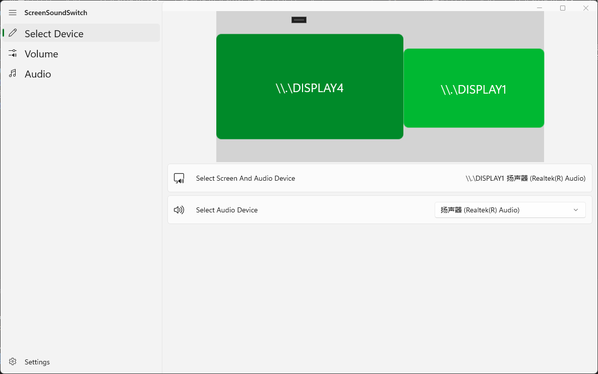
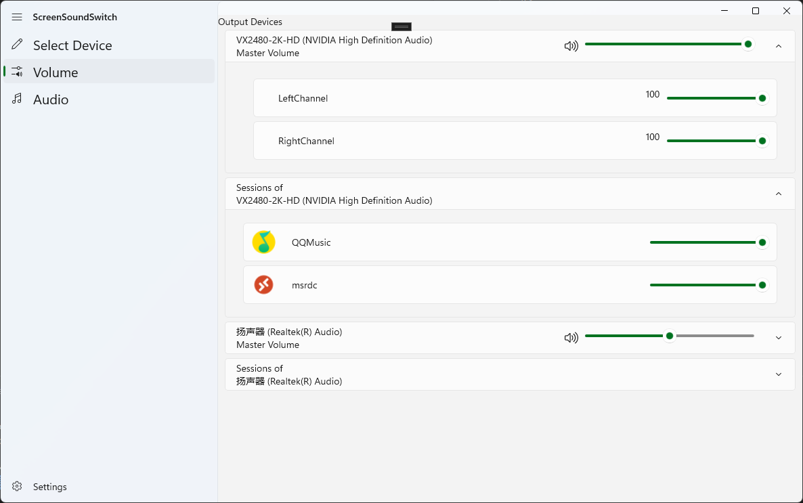

# ScreenSoundSwitch

ScreenSoundSwitch 是一个基于 C# / .NET 8 的 Windows 桌面应用，用于根据应用窗口所在显示器，自动切换该应用使用的音频播放设备。

ScreenSoundSwitch is a C# / .NET 8 Windows desktop app that routes an application's playback device based on which monitor its window is currently on.

## 环境要求

> 以下为从源码开发、构建所需的环境；只想安装发布版的用户请直接查看「下载与安装（发布版）」。

- OS: Windows 10/11
- SDK: .NET 8.0 SDK
- IDE: Visual Studio 2022/2026 (WinUI 3 开发环境)

## 项目概述

本项目聚焦于「多显示器 + 多音响设备」场景：

- 为每个显示器指定一个播放设备
- 监听窗口移动事件
- 当应用窗口跨屏移动时，将该进程的音频会话切换到目标显示器绑定的播放设备

核心实现基于 SoundSwitch 的音频切换能力与窗口事件监听能力，并结合本项目的跨屏路由逻辑扩展。

## 当前能力

- 为每个显示器绑定独立播放设备
- 监听窗口移动并尝试切换对应进程的播放设备
- 使用 `Ctrl + Alt + 鼠标滚轮` 调节当前聚焦进程会话音量
- 显示当前活跃音频设备及对应进程会话

## 已知限制（请务必阅读）

- 某些第三方播放器（例如部分音乐播放器）对系统级“进程默认音频端点”切换并非即时响应。
- 在这类应用中，路由策略可能已写入成功，但实际生效可能依赖播放器内部重建音频流（如切歌、暂停/恢复、重建会话）。
- 这属于目标应用自身音频引擎行为差异，而非本项目可完全强制控制的范围。
- 浏览器（如 Edge、Chrome）同一实例的多个窗口共享同一个音频会话，只能整体切换播放设备，无法按窗口或标签页单独路由。

## 下载与安装（发布版）

发布包通过 GitHub Releases 分发。下面的步骤面向直接使用发布版的用户；如需从源码构建，请查看「构建与运行」。

### 1. 下载发布包

打开 [Releases](https://github.com/Lingwuxin/ScreenSoundSwitch/releases)，在最新版本的 Assets 中下载以下文件：

| 文件 | 说明 |
| --- | --- |
| `ScreenSoundSwitch-<版本>-x64.msix` | 64 位安装包，适用于绝大多数 Intel / AMD 电脑 |
| `ScreenSoundSwitch-<版本>-ARM64.msix` | ARM64 安装包，适用于骁龙等 ARM 设备 |
| `ScreenSoundSwitch-<版本>.cer` | 发布证书，安装 MSIX 前必须先信任 |

- `.cer` 和 `.msix` 请从同一个 Release 下载，避免证书与安装包不匹配。
- 系统要求：Windows 10 1809（Build 17763）及以上；Windows 11 可直接使用。
- 当前发布版依赖 Windows App Runtime 1.6。若安装时提示缺少依赖，请先安装 [Windows App Runtime 1.6](https://learn.microsoft.com/windows/apps/windows-app-sdk/downloads-archive#windows-app-sdk-16)。

### 2. 信任发布证书

本项目使用自签名证书为 MSIX 签名。Windows 默认不信任自签名证书，会拒绝安装，因此需要先把发布证书导入「本地计算机 → 受信任人」。

#### 方式一：图形界面

1. 双击下载的 `.cer` 文件，在证书窗口中点击「安装证书」。
2. 存储位置选择「本地计算机」，点击「下一步」；弹出 UAC 提示时选择「是」。
3. 选择「将所有证书都放入下列存储」，点击「浏览」。
4. 在列表中选择「受信任人」，点击「确定」→「下一步」→「完成」。
5. 看到「导入成功」提示，说明证书已信任。

#### 方式二：管理员 PowerShell

在「开始」菜单搜索 PowerShell，右键选择「以管理员身份运行」，然后执行：

```powershell
# 进入证书所在目录（请按实际下载位置修改）
cd "$env:USERPROFILE\Downloads"

# 把证书导入本地计算机的「受信任人」存储
Import-Certificate -FilePath .\ScreenSoundSwitch-v2.0.1.cer -CertStoreLocation Cert:\LocalMachine\TrustedPeople
```

> 存储位置请选择「本地计算机 → 受信任人」（`Cert:\LocalMachine\TrustedPeople`）。如果只导入到「当前用户」存储，安装 MSIX 时可能仍会提示证书不受信任。

导入后可以检查证书是否就位：

```powershell
Get-ChildItem Cert:\LocalMachine\TrustedPeople |
    Where-Object { $_.Subject -eq 'CN=16124' } |
    Format-List Subject, NotBefore, NotAfter
```

### 3. 安装 MSIX

双击对应架构的 `.msix` 文件，在「应用安装程序」窗口中点击「安装」，等待完成即可。

如果双击没有反应，或系统没有关联「应用安装程序」，可以在 `.msix` 所在目录打开 PowerShell 并执行：

```powershell
# 如果文件在默认下载目录，先进入该目录
cd "$env:USERPROFILE\Downloads"

Add-AppxPackage -Path .\ScreenSoundSwitch-v2.0.1-x64.msix
```

安装完成后，在「开始」菜单搜索 `ScreenSoundSwitch` 启动应用。

### 4. 升级与卸载

**升级**：下载新版本的 `.msix` 直接安装即可覆盖旧版本。每个签名 Release 都会附带对应的 `.cer`；如果之前已经信任过同一发布者的证书，可以跳过导入证书这一步。

**安装失败并提示已存在旧版本**：早期未签名的构建与签名版本使用相同的包名（Identity Name）和发布者，直接覆盖可能提示更新或注册失败。先卸载旧版本，再重新安装：

```powershell
# 本项目的包标识（Identity Name）是固定 GUID，用它来匹配已安装的旧版本
Get-AppxPackage *672a8a13* | Remove-AppxPackage
```

**卸载**：在「设置 → 应用 → 应用和功能 / 已安装的应用」中找到 ScreenSoundSwitch 并卸载，或执行上面的命令。

### 5. 常见问题

| 现象 | 原因与处理 |
| --- | --- |
| 提示 `0x800B0109`：证书链不受信任 | 证书没有导入到「本地计算机 → 受信任人」，或导入到了当前用户存储。按第 2 步重新导入后重试。 |
| 提示 `0x80073D02`：应用正在运行 | 先完全退出 ScreenSoundSwitch（包括托盘图标）再安装。 |
| 提示已安装同一应用 / 更新失败 | 通常是旧版本未签名包导致，参考第 4 步卸载旧版本后重新安装。 |
| 双击 `.msix` 没有反应 | 使用 PowerShell 执行 `Add-AppxPackage -Path <msix 路径>`。 |
| 提示缺少依赖（如 `0x80073CF3`） | 系统缺少 Windows App Runtime 1.6，安装后重试。 |

如果仍无法安装，请在 [Issues](https://github.com/Lingwuxin/ScreenSoundSwitch/issues) 中附上错误码和 Windows 版本。

## 构建与运行

```powershell
dotnet restore
dotnet build ScreenSoundSwitch.WinUI/ScreenSoundSwitch.WinUI.csproj
```

在 Visual Studio 中将 `ScreenSoundSwitch.WinUI` 设为启动项目后运行。

## 使用说明

1. 启动后默认进入「设备」页面，页面会按系统显示设置同步显示器布局。
2. 点击布局中的显示器将其选中，然后在「选择播放设备」下拉框中为该显示器指定播放设备；对每块显示器重复此操作。
3. 打开需要路由的音频应用（如音乐播放器、视频播放器），并确保它已创建音频会话。
4. 将应用窗口拖动到其他显示器，程序会监听窗口位置变化，并把该进程的音频会话切换到目标显示器绑定的播放设备。
5. 切换到「音量」页面可以查看各输出设备及其进程会话；进入该页面后，按住 `Ctrl + Alt` 滚动鼠标滚轮，可调节当前前台进程的会话音量。

## 待推进事项

- 新会话自动发现与自动纳入路由管理
- 托盘常驻与最小化到系统托盘
- 开机自启动
- 配置持久化与启动自动恢复
- 支持浏览器（如 Edge）多窗口/子窗口级别的独立音频设备绑定（当前仅能按进程级别切换）
- 支持用户手动配置播放设备的空间位置（如 3D 拖拽布局），以适配复杂声道拓扑（例如 5.0/5.1、多声道顺序非 0/1 左右对应）

## 功能预览

同步系统设置中的显示器布局


获取正在使用播放设备的进程
